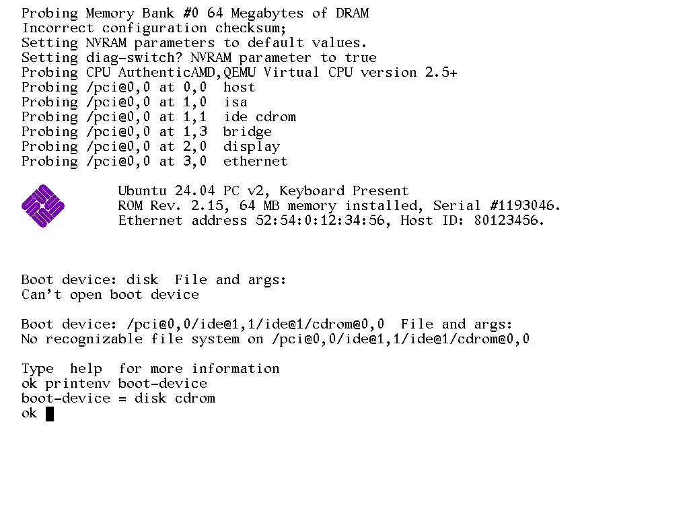

# SunBiosPort: OpenBoot for x86

SunBiosPort is a firmware payload for x86 PCs that looks and behaves like
Sun's OpenBoot PROM (OBP 2.x, as on a SPARCstation 5). You build it into
[coreboot](https://coreboot.org) as the payload, and it gives you:

* the OpenBoot console: Sun's **Gallant 12×22 font**, black text on white, an
  80×34 text window centred on the screen, and the purple **Sun logo** next to
  the banner. The font and logo are the original bitmaps from
  [openbios/openboot](https://github.com/openbios/openboot)
  (`obp/pkg/termemu/gallant.fth`, `obp/pkg/sunlogo/logodata.fth`).
* the OpenBoot power-on messages (`Probing Memory Bank…`, `Incorrect
  configuration checksum`, `Probing CPU…`, `Probing /pci@0,0 at …`) and the banner
  (`ROM Rev. 2.15, 64 MB memory installed, Serial #…`, `Ethernet address …, Host ID: …`);
* the `ok` prompt: a Forth interpreter with OpenBoot's commands (`boot`,
  `printenv`, `setenv`, `devalias`, `show-devs`, `probe-scsi`, `banner`, `dump`, `see`, …);
* `boot` that works for **x86** operating systems: x86 Solaris and illumos
  (Multiboot), Linux, and anything else through a legacy-BIOS hand-off.



*SunBiosPort as the coreboot payload in QEMU (`-m 64`, no boot media).*

> **What "port" means here:** OpenBoot's kernel is SPARC assembly and its
> drivers are SPARC/SBus/FCode-specific, so they can't run on a PC. This
> project re-implements OpenBoot's user interface and boot behaviour in C for
> x86, and reuses OpenBoot's original font and logo data. The model name in
> the banner comes from the machine's SMBIOS (in QEMU, e.g. "Standard PC");
> you can set your own with `setenv oem-banner?`/`oem-banner`, as on a real Sun.

## Getting the `.elf`

A prebuilt payload is in [`dist/sunbios.elf`](dist/sunbios.elf) (32-bit ELF,
linked at 32 MiB). To build it yourself on Linux you need `gcc` with 32-bit
support (`gcc-multilib`), `binutils`, `nasm`, `make` and `python3`:

```sh
make            # -> build/sunbios.elf
make dist       # copy it to dist/sunbios.elf
```

NVRAM settings are saved in the second CMOS bank (ports 0x72/0x73, bytes
0xa0–0xff; on the ThinkPad T60 coreboot only uses 0x80–0x84 of that bank). Saved
across reboots: `auto-boot?`, `diag-switch?`, `boot-device` (31 characters),
`boot-file` (39), `boot-entry`, `oem-banner?`, `oem-banner` (18),
`use-nvramrc?`, `legacy-fallback?`, and `output-device ttya`. As on a Sun, the
"Incorrect configuration checksum" message only appears when that block is
missing or damaged (the first boot, or after a CMOS battery reset); it then sets
`diag-switch?` to true, as in the screenshot. `setenv diag-switch? false` gives
the normal quiet boot: banner, then `Boot device: …`. Build with
`make NVRAM_CMOS=0` if your board uses that CMOS area (settings then last until
reset). `make OBP_REV=3.11` changes the "ROM Rev." in the banner.

## Putting it into coreboot

1. In coreboot's `make menuconfig`:
   * **Payload → Payload to add → An ELF executable payload**, and set
     **Payload path and filename** to `sunbios.elf`;
   * **Devices → Display → Framebuffer mode → Linear "high-resolution"
     framebuffer** (the logo and Gallant font need a graphics framebuffer; with a
     VGA text console you still get OpenBoot, just in 80×25 text without the logo).
     A 1024×768 mode matches a Sun console exactly. Higher resolutions keep the
     80×34 window centred, like OBP does.
2. *(Recommended)* Add SeaBIOS as a secondary payload called `img/seabios`. This
   is what `boot legacy` and the legacy fallback start:
   ```sh
   # in a SeaBIOS tree configured with CONFIG_COREBOOT=y
   make
   cbfstool build/coreboot.rom add-payload -f out/bios.bin.elf -n img/seabios -c lzma
   ```
3. Flash `coreboot.rom` as usual.

[`configs/coreboot-qemu-i440fx.defconfig`](configs/coreboot-qemu-i440fx.defconfig)
is the configuration I used to test with coreboot on QEMU.

To try it **without coreboot**, the same ELF is also a Multiboot kernel:

```sh
qemu-system-x86_64 -m 512 -kernel dist/sunbios.elf -cdrom some.iso -serial stdio
```

or from GRUB: `multiboot /sunbios.elf`. When it is started this way on a normal PC
BIOS, `boot legacy` and the legacy fallback hand control back to that BIOS.

## Booting

```
ok boot                       \ boot-device, then boot-file (default: disk, then cdrom)
ok boot cdrom                 \ install media: uses the CD's GRUB / isolinux menu
ok boot disk1:b               \ second partition of the second disk
ok boot disk -s               \ extra arguments are appended to the kernel's (here: single user)
ok boot disk /boot/vmlinuz root=/dev/sda1   \ a named kernel plus arguments
ok boot net                   \ DHCP/BOOTP, then TFTP
ok boot legacy                \ hand over to a PC BIOS (SeaBIOS from CBFS)
ok .entries cdrom             \ list the boot menu on a device...
ok setenv boot-entry 1        \ ...and pick an entry (-1 = the menu's default)
ok dir cdrom /boot/grub       \ list files;  cat cdrom /boot/grub/menu.lst  shows one
ok load disk /stand/prog  go  \ load at load-base and run
```

To stop auto-boot and get the `ok` prompt, use **Stop-A**: on a PC keyboard
hold **F1** and press **A** (the same key combination Solaris x86 uses), or send
a BREAK on the serial console, as on a Sun's ttya. Other keys are ignored.

How `boot <device>` decides what to do:

1. It reads the partition table (MBR, extended partitions, GPT, and the **Solaris
   x86 fdisk partition + VTOC slices**) and mounts the first filesystem it
   recognises: **ISO 9660** (Rock Ridge/Joliet), **UFS** (Solaris/BSD UFS1),
   **ext2/3/4**, **FAT12/16/32**.
2. It looks for a boot menu: GRUB legacy `menu.lst` (Solaris 10, OpenSolaris,
   Solaris 11.0), GRUB 2 `grub.cfg` (Solaris 11.1+, Linux), or
   `isolinux.cfg`/`syslinux.cfg`/`extlinux.conf`. It expands `kernel$`/`module$`
   and `$ISADIR` (to `amd64` on 64-bit CPUs) the way Solaris' GRUB does.
3. With no menu but a Solaris root (`/platform/i86pc/kernel/[amd64/]unix` and a
   `boot_archive`), it boots that directly.
4. It loads the kernel according to its format: **Multiboot** (v1 and v2, ELF
   or a.out-kludge; this is how x86 Solaris and illumos kernels boot), **Linux
   bzImage** (32-bit boot protocol, initrds, e820 map, framebuffer info), or a plain
   **ELF** (started like a coreboot payload).
5. If the device has no filesystem/menu but has PC boot code (an MBR or an El
   Torito image), it is handed to the legacy BIOS (`legacy-fallback?`).

`boot net` uses the Intel e1000 family NIC: DHCP/BOOTP, then TFTP. If the boot
file is `pxegrub` (Solaris PXE/JumpStart servers), it fetches
`menu.lst.01<MAC>` (or `boot/grub/menu.lst`) and loads the kernel and boot archive
from it. For `pxelinux.0` it uses `pxelinux.cfg/`.

### x86 Solaris

| Solaris release / medium | How to boot it |
|---|---|
| Solaris 10 (1/06 or later), OpenSolaris, Solaris 11.0 install CD/DVD | `boot cdrom` (GRUB `menu.lst`, Multiboot) |
| Solaris 11.1 – 11.4 install media | `boot cdrom` (GRUB 2 `grub.cfg`, Multiboot or Multiboot2) |
| Solaris 10 installed on UFS | `boot disk` (VTOC slice → UFS → `/boot/grub/menu.lst`) |
| Solaris 11 installed on ZFS (ZFS isn't readable natively) | `boot legacy` (SeaBIOS → the disk's GRUB) |
| Solaris 2.5.1 – 9 x86 (need a real-mode BIOS) | `boot legacy` |
| PXE / JumpStart network install | `boot net` |

Things to know:

* **Testing:** I could not download Solaris or illumos media in the environment
  I built this in, so the native Solaris path is tested with disks and CDs laid
  out exactly like Solaris media (Rock Ridge ISO with `menu.lst`/`grub.cfg`,
  fdisk type `0xbf` + VTOC + UFS root slice) and a test kernel that checks what it
  receives. It is not yet tested with a real Solaris kernel. If a native boot
  hangs or panics early, `boot legacy` still works with any release.
* **Console:** Solaris 10 writes its console to VGA text mode. Started from a
  PC BIOS (QEMU, GRUB), SunBiosPort switches the screen back to text mode before
  starting the kernel. Under coreboot with a linear framebuffer there is no text
  mode to return to, so the screen stays blank after the hand-off. In that case
  boot with a serial console (`boot cdrom -B console=ttya`), or use `boot legacy`
  (SeaBIOS provides a text console). Linux and Multiboot2 kernels are given the
  framebuffer.

## OpenBoot commands

| Area | Commands |
|---|---|
| Boot | `boot`, `load`, `go`, `dir`, `cat`, `.entries`, `cbfs-list`, `cbfs-boot` |
| NVRAM | `printenv`, `setenv`, `set-default`, `set-defaults`, `devalias`, `nvalias`, `nvrun` |
| Devices | `show-devs`, `show-disks`, `dev`/`cd`, `ls`, `pwd`, `.properties`, `probe-pci`, `probe-ide`, `probe-scsi`, `probe-sata`, `probe-nvme` |
| Diagnostics | `banner`, `test`, `test-all`, `watch-clock`, `time&date`, `.version`, `.speed`, `.enet-addr`, `.idprom`, `.memory`, `module-info` |
| System | `reset-all`, `reset`, `power-off`, `help` |
| Memory / I/O | `dump`, `@ ! c@ c! w@ w! l@ l!`, `fill`, `move`, `comp`, `inb outb inw outw inl outl`, `config-l@ config-l! config-w@ config-b@` |
| Forth | `: ;`, `if else then`, `do ?do loop +loop leave`, `begin until again while repeat`, `variable constant value create does> defer is to`, `' ['] execute`, `see`, `words`, `." .( " s"`, `d# h#`, `.s . u. .h .d .r`, `hex decimal`, … |

As in OpenBoot, numbers are **hex by default**. `if`/`do` loops also work
directly at the `ok` prompt. The line editor supports the arrow keys or
^B/^F/^A/^E/^D, ^U to erase, and ^P/^N (or up/down) for history.

NVRAM variables: `auto-boot?`, `boot-device`, `boot-file`, `boot-entry`,
`diag-switch?`, `diag-device`, `diag-file`, `output-device` (`screen` or `ttya`),
`oem-banner?`, `oem-banner`, `use-nvramrc?`, `nvramrc`, `legacy-fallback?`,
`load-base`, and the rest of the OBP 2.x set.

## Hardware support

* **Display:** coreboot linear framebuffer (15/16/24/32 bpp), Multiboot
  framebuffer, QEMU/Bochs VGA (set to 1024×768), or VGA text mode as a fallback.
* **Input:** PS/2 keyboard (the controller is switched to scan-code translation,
  which coreboot leaves off) and the serial port (115200 8N1 by default, or what
  coreboot reports). All output goes to both the screen and the serial port.
* **Storage:** IDE/PATA (legacy and PCI-native, disks and ATAPI CD/DVD), AHCI SATA
  (disks and ATAPI), NVMe.
* **Network:** Intel 8254x/8257x (e1000/e1000e). Other NICs only report their MAC
  address for the banner (RTL8139).

Limitations:
* **No USB keyboard or USB storage.** On machines with only USB keyboards, use
  the serial console or a PS/2 keyboard.
* No ZFS, no UEFI booting, and kernels and modules are loaded below 4 GiB.
* No FCode (x86 PCI cards don't carry FCode).

## Tests

`tests/mkmedia.sh` builds test disks and CDs (Solaris-10 and Solaris-11 style
ISOs, a Solaris VTOC/UFS disk, syslinux/FAT, GRUB2/ext4, an MBR-only disk, an El
Torito CD). `tests/run-tests.sh` boots each one in QEMU and checks what the
kernel received. Set `COREBOOT_ROM=` to also run them with SunBiosPort as the
coreboot payload. All 15 pass, including Linux booting to userspace from an
isolinux CD and from GRUB2 on ext4, and SeaBIOS chain-loading from CBFS.

## Licences

SunBiosPort is under the GNU GPL v3 (see `LICENSE`). The Gallant font and Sun
logo bitmaps are © 1990–1994 Sun Microsystems, Inc., and are redistributed
under the terms in [`third_party/openboot/LICENSE.sun`](third_party/openboot/LICENSE.sun).
"Sun" and the Sun logo are trademarks of Oracle; this project is not affiliated
with Oracle.
